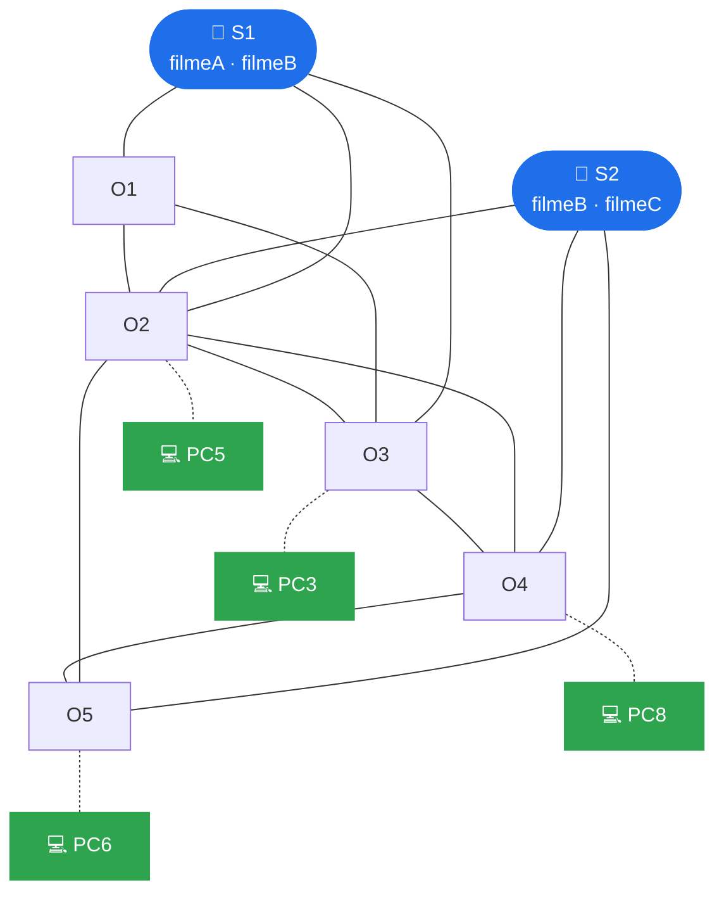

<div align="center">

# 🎬 OTT Overlay Streaming

**Serviço de streaming de vídeo sobre uma rede *overlay* aplicacional, com árvores de distribuição por servidor e encaminhamento adaptativo**


*Engenharia de Serviços em Rede · Trabalho Prático 2 · Grupo PL31*

</div>

---

## 📖 Sobre o projeto

Um serviço *Over-the-Top* em que vários **servidores** transmitem vídeo a vários **clientes** através de uma rede de **onodes** (nós do *overlay*) emulada no [CORE](https://github.com/coreemu/core).

Cada onode conhece **apenas os seus vizinhos**. Para cada servidor guarda só por onde o vídeo lhe chega (a sua **Origem**) e quanto custa esse caminho. As árvores de distribuição não estão escritas em lado nenhum: são o resultado das escolhas locais de todos os onodes. O vídeo só segue pelos ramos que têm clientes.


<sub>Topologia 3: 2 servidores, 5 onodes e 4 clientes.</sub>

## Funcionalidades

| | |
|---|---|
| **Árvores por servidor** | Construídas a pedido com `ATIVAR`/`DESATIVAR` (como no PIM-SM), com RPF e poda quando não há clientes |
| **Métrica adaptativa** | Custo = 1×salto + 2×atraso (RTT local) + 3×perdas (medidas com o próprio vídeo) + 1×carga |
| **Vetor de distâncias** | Números de sequência por servidor, *split horizon*, condição de viabilidade (Babel/EIGRP) e *route poisoning* |
| **Recuperação de falhas** | Mudança de Origem em ~50 ms quando um nó cai, e regresso à melhor rota quando ele volta |
| **Falhas duplas** *(extra)* | `ENDANGERED`: o nó em risco pergunta ao vizinho que lhe resta qual é o próximo salto e, se também esse cair, abre uma ligação de recurso |
| **Visualização ao vivo** *(extra)* | `tools/arvore.py` desenha as árvores de todos os servidores em tempo real |
| **Silêncio onde não há fluxo** | Numa ligação sem vídeo só passam os *heartbeats* (10 s); o cliente recebe apenas RTP |

## Arquitetura

| Componente | Função | Transporte |
|---|---|---|
| `bootstrapper.py` | Diz a cada nó quem são os seus vizinhos (só no arranque) | TCP 5000 |
| `servidor.py` | Lê os vídeos MJPEG, anuncia-se e envia o vídeo pelas árvores | TCP 6000 · UDP 6001 |
| `onode.py` | Encaminha o controlo e o vídeo; serve os clientes ligados a ele | TCP 6000 · UDP 6001/6003 |
| `cliente.py` | Pede uma stream ao seu onode, mostra-a e calcula estatísticas RTP | UDP 6003 |
| `ottctl.py` | Consola de gestão local de um onode | TCP 6002 (localhost) |

O controlo usa TCP persistente por vizinho, com mensagens JSON (uma por linha). O vídeo vai em UDP: entre onodes num cabeçalho próprio com nº de sequência por ligação, e para o cliente em **RTP puro**. Os formatos estão em [`message_types.md`](Projeto/message_types.md).

## Como correr

Dentro do CORE, abre uma das topologias de [`Topologia/`](Topologia) e corre em cada PC:

```bash
# Bootstrapper
python3 bootstrapper.py configs/overlay_topo3.json

# Servidores
python3 servidor.py <ip_bootstrapper> filmeA filmeB

# Onodes
python3 onode.py <ip_bootstrapper>

# Clientes
python3 cliente.py <ip_do_seu_onode> filmeA
```

Os comandos para cada PC das Topologias 1, 2 e 3 estão no guião [`DEMO.md`](Projeto/DEMO.md).

**Comandos no terminal de um onode:**

| Comando | Mostra |
|---|---|
| `rotas` | Origem, métrica, destinos e alternativas de cada fluxo |
| `vizinhos` | RTT, perdas, carga e decomposição do custo de cada ligação |
| `ping` | Caminho percorrido pelos fluxos ativos (no servidor) |
| `estado` | Estado local em JSON |
| `sair` | Saída ordeira (`ADEUS`) |

**Ver as árvores ao vivo** (na shell do contentor do CORE):

```bash
python3 tools/arvore.py --core --watch 2
```

## Testes

Os testes correm toda a Topologia 3 numa só máquina, sem CORE (cada nó num IP `127.x`):

```bash
cd Projeto
python3 tests/test_scenarios.py      # 26 verificações (T1–T12)
python3 tests/test_falha_dupla.py    # 13 verificações (F1–F5)
python3 tools/testar_heartbeat.py    # experiência que escolheu o heartbeat de 10 s
```

Cobrem: árvore partilhada, falha abrupta, saída ordeira e nó congelado, mudança por atraso e por perdas (com *hold-down*), *route poisoning*, regresso à melhor rota e silêncio numa ligação sem fluxo.

## Estrutura

```
├── ESR-TP2-26-27.pdf          enunciado
├── Topologia/                 topologias CORE (.xml) das Topologias 1, 2 e 3
└── Projeto/
    ├── bootstrapper.py  servidor.py  onode.py  cliente.py  ottctl.py
    ├── comum/                 configuração, mensagens, RTP, estatísticas
    ├── servicos/              vizinhos, rotas, fluxos, dados, reparação
    ├── configs/               vizinhos de cada topologia (JSON)
    ├── tools/                 arvore.py, testar_heartbeat.py, gen_video.py
    ├── tests/                 testes automáticos
    └── videos/                filmeA, filmeB, filmeC (MJPEG)
```

## 📚 Documentação

| Documento | Conteúdo |
|---|---|
| [`Projeto/README.md`](Projeto/README.md) | Decisões de desenho, protocolo, métrica, falhas e testes em detalhe |
| [`Projeto/DEMO.md`](Projeto/DEMO.md) | Guião da demonstração passo a passo |
| [`Projeto/ARVORES_TOPO3.md`](Projeto/ARVORES_TOPO3.md) | Árvores possíveis e escolhidas na Topologia 3 |
| [`Projeto/message_types.md`](Projeto/message_types.md) | Formato de todas as mensagens |

## 👥 Autores

<div align="center">

| | Nome | Número |
|:-:|---|:-:|
| 👤 | Diogo Costa | PG63943 |
| 👤 | João Tomás | PG63985 |
| 👤 | Hugo Cunha | PG63972 |

**Universidade do Minho** · Engenharia de Serviços em Rede (Perfil A) · Turno PL3 · 2026/27

</div>
